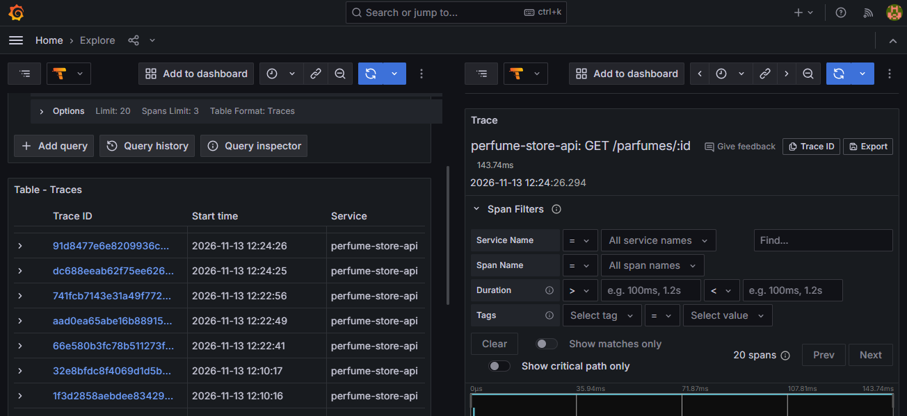
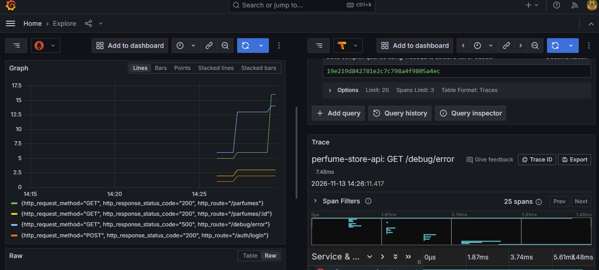
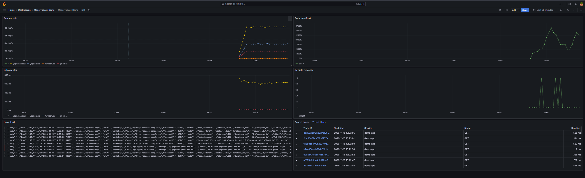
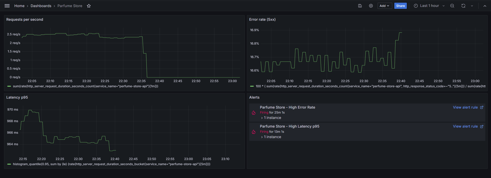
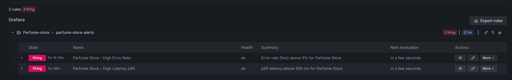
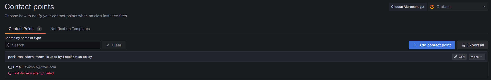

## API документація

API проєкту описаний за допомогою OpenAPI 3.0.

### OpenAPI контракт

[Переглянути `openapi.yaml`](docs/api/openapi.yaml)

### Swagger Editor

Специфікація API була перевірена та відображена в Swagger Editor.


# Docker

Структура проєкту:

- frontend — React/Vite застосунок
- backend — Node.js API (PostgreSQL)
- docker-compose.yml — сервіси web, api, db

## 1. Перевірка Docker

```
docker version
docker run hello-world
```

Очікуваний результат: у виводі є «Hello from Docker!».

[Переглянути скрішот працездатності](docs/docker/image.png)

## 2. Контейнеризація застосунку

Файли:

- frontend/Dockerfile, frontend/.dockerignore, frontend/nginx.conf
- backend/Dockerfile, backend/.dockerignore

### Frontend (React/Vite + Nginx)

```
cd frontend
npm run build
docker build -t parfumes-web:1.0.0 .
docker run --name web --rm -d -p 5173:80 parfumes-web:1.0.0
docker logs web
docker stop web
```

Порт доступу: http://localhost:5173

### Backend (Node.js API)

Перед запуском створити backend/.env за зразком backend/.env.example.

```
docker build -t parfumes-api-node:1.0.0 ./backend
docker run --name api --rm -d -p 5000:5000 --env-file backend/.env parfumes-api-node:1.0.0
docker logs api
docker stop api
```

Порт доступу: http://localhost:5000 (перевірка: http://localhost:5000/health)

[Переглянути скрішот працездатності](docs/docker/container.png)

## 3. Docker Compose (web + api + db)

Сервіси:

- web — frontend (Nginx), http://localhost:5173
- api — backend, http://localhost:5000
- db — PostgreSQL 15, порт 5432

Змінні середовища API (PORT, DATABASE_URL, SECRET_KEY) беруться з backend/.env.

### Запуск

```
docker compose up -d --build
```

### Перевірка

```
docker ps
docker logs web
docker logs api
curl http://localhost:5000/health
```

Очікувана відповідь API: {"status":"ok"}

У застосунку є middleware, який навмисно повертає випадкові помилки 500/503 приблизно для 20% запитів, тому за потреби запит треба повторити.

Frontend: http://localhost:5173

### Зупинка

```
docker compose down
```

## Відтворення з нуля на чистій машині

1. Встановити Docker Desktop і перевірити: docker version, docker run hello-world.
2. Клонувати репозиторій.
3. Створити backend/.env за зразком backend/.env.example.
4. Виконати docker compose up -d --build.
5. Відкрити http://localhost:5173 і перевірити API: curl http://localhost:5000/health.
6. Зупинити: docker compose down.

# CI/CD

## Client CI

Client CI: [https://github.com/irynaboyarska/parfumes-store/actions/workflows/client-ci.yml](https://github.com/irynaboyarska/parfumes-store/actions/workflows/client-ci.yml)

### Локальний запуск клієнта

```bash
npm run dev
npm ci
```

### Перевірки

```bash
npm run lint
npm run test:ci
npm run build
```

### Артефакти

Після виконання workflow зберігаються:

- `frontend-coverage` — звіт покриття тестами;
- `frontend-junit` — результати тестування у форматі JUnit;
- `frontend-dist` — production-збірка frontend.

## Server CI

Server CI: [https://github.com/T1pOK220/parfumes-store/actions/workflows/server-ci.yml](https://github.com/T1pOK220/parfumes-store/actions/workflows/server-ci.yml)

## Delivery: GitHub Container Registry

Для доставки застосунку використовуються Docker-образи, які автоматично збираються та публікуються в GHCR після успішного проходження відповідних перевірок.

Frontend:

`ghcr.io/irynaboyarska/parfumes-store-client:v1.0.1`

Backend:

`ghcr.io/T1pOK220/parfumes-store-server:v1.0.0`

### Посилання

- Client CI: [https://github.com/irynaboyarska/parfumes-store/actions/workflows/client-ci.yml](https://github.com/irynaboyarska/parfumes-store/actions/workflows/client-ci.yml)
- Server CI: [https://github.com/irynaboyarska/parfumes-store/actions/workflows/server-ci.yml](https://github.com/irynaboyarska/parfumes-store/actions/workflows/server-ci.yml)
- Client package: [https://github.com/irynaboyarska/parfumes-store/pkgs/container/parfumes-store-client](https://github.com/irynaboyarska/parfumes-store/pkgs/container/parfumes-store-client)
- Server package: [https://github.com/T1pOK220/parfumes-store/pkgs/container/parfumes-store-server](https://github.com/T1pOK220/parfumes-store/pkgs/container/parfumes-store-server)

## Style points

У проєкті реалізовані додаткові практики CI/CD:

1. **Семантичне тегування** — використання версій `vX.Y.Z` та SHA-тегів для ідентифікації Docker-образів.
2. **Посилений контроль permissions** — мінімальні права доступу `contents: read`, а `packages: write` надається лише job публікації.
3. **Concurrency control** — скасування попередніх запусків workflow для тієї самої групи через `cancel-in-progress`.
4. **Job Summary** — автоматичне формування звіту з показниками test coverage, посиланнями на запуск та інформацією про Docker-образи.
5. **Trivy security scan** — перевірка Docker-образів на вразливості.
6. **Dependabot** — автоматичне оновлення npm-залежностей та GitHub Actions.

# Observability

для початку потрібно встановити нові залежності

```
npm install

```

## Запуск стенду та API

Порядок важливий: спочатку стенд моніторингу (він створює docker-мережу `observability-demo`), потім Perfume Store.

```powershell
cd observability-demo
docker compose up -d --build
docker compose stop loadgen

cd parfumes-store
docker compose up -d --build
```

Перевірка, що все працює:

```powershell
docker compose ps
```

| Сервіс                     | Адреса                | Примітка                |
| -------------------------- | --------------------- | ----------------------- |
| Grafana                    | http://localhost:3001 | admin / admin           |
| Prometheus                 | http://localhost:9090 | Status → Targets        |
| Tempo                      | http://localhost:3200 | через Grafana → Explore |
| Loki                       | http://localhost:3100 | через Grafana → Explore |
| OTel Collector (OTLP HTTP) | http://localhost:4318 |                         |
| Perfume Store API          | http://localhost:5000 | наш сервіс              |
| Perfume Store web          | http://localhost:5173 | фронтенд                |

## Запуск навантаження

Скрипт `backend/scripts/load.ps1` (PowerShell):

```powershell
cd parfumes-store\backend
powershell -ExecutionPolicy Bypass -File scripts/load.ps1 -Rounds 30
```

Параметри:

- `-Base http://localhost:5000`: адреса API
- `-Rounds 200`: кількість кіл (одне коло ≈ 1 секунда)

Скрипт викликає такі маршрути:

| Запит              | Для чого                               |
| ------------------ | -------------------------------------- |
| `GET /parfumes`    | звичайний успішний запит               |
| `GET /parfumes/8`  | запит за id (є db-спан)                |
| `GET /debug/error` | завжди відповідає 500 (для error rate) |
| `GET /debug/slow`  | відповідає з затримкою                 |
| `POST /auth/login` | логін                                  |

Після запуску зачекай 20-30 секунд: застосунок експортує метрики раз на 10 с, Prometheus скрейпить раз на 5 с.

## Скриншоти

### Tempo (трейси)

Grafana → Explore → datasource Tempo → фільтр `service.name = perfume-store-api`.



### Prometheus (метрики)

Prometheus → Graph, запит `{service_name="perfume-store-api"}`.



## Метрики

Метрики API надходять через OpenTelemetry (HTTP-інструментація Node.js) і OTel Collector, який віддає їх Prometheus на `collector:8889`.

| Метрика                                       | Що це                                   |
| --------------------------------------------- | --------------------------------------- |
| `http_server_request_duration_seconds_count`  | кількість запитів                       |
| `http_server_request_duration_seconds_sum`    | сумарний час запитів                    |
| `http_server_request_duration_seconds_bucket` | гістограма для перцентилів (лейбл `le`) |
| `db_client_operation_duration_seconds_*`      | запити до БД                            |

### Лейбли

| Лейбл                       | Значення                                     |
| --------------------------- | -------------------------------------------- |
| `service_name`              | `perfume-store-api`                          |
| `http_route`                | `/parfumes`, `/parfumes/:id`, `/debug/error` |
| `http_request_method`       | `GET`, `POST`                                |
| `http_response_status_code` | `200`, `404`, `500`                          |
| `db_operation_name`         | `SELECT`, `INSERT` (для метрик БД)           |

### `service_name` / `service.name`

Через Collector у Prometheus потрапляють метрики всіх сервісів (`perfume-store-api`, `demo-app`, внутрішні метрики `otelcol-contrib`), тому в кожному запиті фільтруємо:

```promql
service_name="perfume-store-api"
```

- У **Prometheus** лейбл пишеться з підкресленням: `service_name`.
- У **Tempo** атрибут пишеться з крапкою: `service.name = perfume-store-api`.
- Не фільтруємо за `job`: `job="perfume-store-api"` це лише назва scrape-завдання на Collector, там змішані дані.

### Атрибути спанів (Tempo)

- `http.request.method`, `http.response.status_code`, `url.path`, `http.route`
- `db.operation.name` (тип операції з БД, наприклад SELECT)

### Приклади PromQL

```promql
# Requests per second
sum(rate(http_server_request_duration_seconds_count{service_name="perfume-store-api"}[1m]))

# Error rate (5xx), %
100 * (
  sum(rate(http_server_request_duration_seconds_count{service_name="perfume-store-api", http_response_status_code=~"5.."}[5m]))
  /
  sum(rate(http_server_request_duration_seconds_count{service_name="perfume-store-api"}[5m]))
)

# Latency p95 (секунди)
histogram_quantile(0.95, sum by (le) (rate(http_server_request_duration_seconds_bucket{service_name="perfume-store-api"}[5m])))

# Операції з БД
sum by (db_operation_name) (rate(db_client_operation_duration_seconds_count[5m]))
```

## Grafana: дашборд і алерти

### Перевірка готового стенду

Дашборд Observability Demo / RED показує Rate, Errors і Duration сервісу demo-app, логи з Loki та список трейсів з Tempo.



### Дашборд Parfume Store

JSON дашборду: [docs/observability/parfume-store-red-dashboard.json](./docs/observability/parfume-store-red-dashboard.json)

Запити панелей наведено в розділі «Приклади PromQL». Усі панелі використовують спільний часовий діапазон дашборду (Last 1 hour), власного Relative time або Time shift у панелей немає.



Requests per second. Показує кількість запитів до API за секунду. У проді за ним видно навантаження та раптові провали трафіку.

Error rate (5xx). Показує відсоток відповідей 5xx від усіх запитів. У проді це основний показник справності сервісу, на ньому побудовано алерт.

Latency p95. Показує час, швидше за який обробляється 95% запитів. У проді виявляє деградацію, яку не видно по середньому значенню.

Alerts. Панель Alert list показує алерти зі станами Firing, Pending та Error.

### Алерти

Contact point: `parfume-store-team` (Email). Default notification policy спрямовує всі алерти на цей contact point. Алерти лежать у групі `parfume-store-alerts`, інтервал перевірки 1m, pending period 1m.

Parfume Store - High Error Rate

- Запит:

```promql
100 * (
  sum(rate(http_server_request_duration_seconds_count{service_name="perfume-store-api", http_response_status_code=~"5.."}[5m]))
  /
  sum(rate(http_server_request_duration_seconds_count{service_name="perfume-store-api"}[5m]))
)
```

- Умова: Reduce (Last), Threshold IS ABOVE 5, тобто частка відповідей 5xx більша за 5%.
- Чому корисний: помилки 5xx означають, що користувачі не можуть виконати запит (наприклад, оформити замовлення), і про це треба дізнатися раніше, ніж повідомлять клієнти.
- Дії команди: відкрити дашборд, у Tempo знайти trace із помилкою за http.route і статусом 500, визначити span, де виникла помилка, виправити причину або відкотити останній реліз.

Parfume Store - High Latency p95

- Запит:

```promql
histogram_quantile(0.95, sum by (le) (rate(http_server_request_duration_seconds_bucket{service_name="perfume-store-api"}[5m])))
```

- Умова: Reduce (Last), Threshold IS ABOVE 0.5, тобто p95 більший за 500 мс (метрика в секундах).
- Чому корисний: повільні відповіді погіршують досвід користувача й часто передують збоям.
- Дії команди: визначити повільний маршрут за http_route, у Tempo знайти trace з найбільшою тривалістю і подивитися, який span займає найбільше часу (наприклад, запит до БД), оптимізувати запит або масштабувати сервіс.

### Перевірка спрацювання алертів

Для перевірки використано навантаження зі скрипта `load.ps1` (маршрути `/debug/error` і `/debug/slow`). Обидва алерти пройшли стани Normal, Pending, Firing. Сторінка Alert rules показує обидва правила в групі `parfume-store-alerts` зі статусом Firing.



Contact point `parfume-store-team` підключено до Default notification policy: обидва алерти (2 instances) маршрутизуються на нього, групування за `grafana_folder` і `alertname`. Статус Last delivery attempt failed очікуваний: у Grafana стенду не налаштовано SMTP, тому листи на example@gmail.com не доставляються, але маршрут алертів налаштовано правильно.



# Kubernetes demo(k8s)


## 1. Локальний запуск і перевірка ендпоінтів

Кроки: клонування форку, `npm install`, `npm run dev`.

Результати перевірки ендпоінтів:

| Ендпоінт | Відповідь |
| --- | --- |
| `/api/status` | `{"status":"ok","appMode":"dev","version":"1.0.0","timestamp":"2026-11-19T17:35:08.734Z"}` |
| `/api/items?filter=a` | `[{"id":1,"name":"Item A"}]` |
| `/api/slow` | `{"status":"ok","delayMs":2000}` |
| `/api/error` | `{"status":"ok","message":"No error"}` |
| `/healthz` | `ok` |
| `/ready` | `{"status":"ready"}` |

---

## 2. Docker

**Збірка образу:**

```bash
docker build -t k8s-demo-app:1.0.0 .
```

**Запуск контейнера:**

```bash
docker run --rm -p 8080:8080 -e SECRET_TOKEN=local k8s-demo-app:1.0.0
```

**Приклад відповіді `/api/status`:**

```json
{"status":"ok","appMode":"dev","version":"1.0.0","timestamp":"2026-11-19T17:46:24.353Z"}
```

---

## 3. Minikube і базовий деплой

- Кластер запущено через `minikube start`; контекст `kubectl` — `minikube`.
- Статус ноди: **Ready**.
- Застосовано маніфести: namespace, configmap, secret, deployment, service.

**Вивід `kubectl get deployment,rs,pods,svc -n k8s-demo`:**

```text
PS C:\Users\Admin\Desktop\k8s-demo\k8s> kubectl get deployment,rs,pods,svc -n k8s-demo
NAME                           READY   UP-TO-DATE   AVAILABLE   AGE
deployment.apps/k8s-demo-api   2/2     2            2           10m

NAME                                      DESIRED   CURRENT   READY   AGE
replicaset.apps/k8s-demo-api-5c45559886   0         0         0       10m
replicaset.apps/k8s-demo-api-65596c66d    2         2         2       2m21s

NAME                               READY   STATUS    RESTARTS   AGE
pod/k8s-demo-api-65596c66d-r58cs   1/1     Running   0          2m15s
pod/k8s-demo-api-65596c66d-vhls5   1/1     Running   0          2m21s

NAME                   TYPE        CLUSTER-IP      EXTERNAL-IP   PORT(S)   AGE
service/k8s-demo-api   ClusterIP   10.103.188.58   <none>        80/TCP    10m
```

**Port-forward** `svc/k8s-demo-api` на `8080:80` і перевірка:

```bash
curl http://localhost:8080/api/items
```

```json
[{"id":1,"name":"Item A"},{"id":2,"name":"Item B"},{"id":3,"name":"Item C"}]
```

---

## 4. Ingress і діагностика

Після налаштування Ingress Controller створено ресурс `k8s-demo-ingress` з host **`k8s-demo.local`**.

### Проблема

Під час перевірки прямого доступу до Minikube за адресою `192.168.49.2` Windows не зміг встановити TCP-з'єднання з портами `80` та `31149`.

### Діагностика

Використані команди: `minikube status`, `kubectl get svc`, `kubectl get endpoints`, `Test-NetConnection`.

Результат:

- Minikube працює через Docker Driver;
- Ingress Controller у стані `Running`;
- Service Ingress Controller має тип `NodePort`.

### Обхід

Використано `kubectl port-forward` напряму до Ingress Controller:

```bash
kubectl port-forward -n ingress-nginx deployment/ingress-nginx-controller 8080:80
```

Після створення тунелю виконано HTTP-запити з заголовком `Host: k8s-demo.local`:

| Запит | Результат |
| --- | --- |
| `GET /api/status` | HTTP 200 OK, JSON із підтвердженням працездатності |
| `GET /api/items` | HTTP 200 OK, список із трьох елементів |

### Висновок

Підтверджено коректну роботу Ingress Controller, маршрутизації за Host, взаємодії із Service та доступності Express API. Проблема стосувалася мережевого доступу до Minikube з Windows, а не конфігурації застосунку.

### Debug-флоу

| Рівень | Команда | Що показує |
| --- | --- | --- |
| Pod | `kubectl get pods -n k8s-demo` / `kubectl logs <pod> -n k8s-demo` | Статус pod-ів, рестарти, логи застосунку |
| Service | `kubectl get svc,endpoints -n k8s-demo` | Тип і порти Service, чи є endpoints (IP pod-ів) за селектором |
| Ingress | `kubectl describe ingress -n k8s-demo` | Host, path, backend-сервіс, події контролера |

Додатково при помилках: `kubectl logs -n ingress-nginx <controller-pod>`, `kubectl get events -n k8s-demo`.

---

## 5. Шлях запиту через `k8s-demo.local`

```text
Клієнт (curl, Host: k8s-demo.local)
        │
        ▼
Ingress Controller (ingress-nginx) — вибирає правило за host/path з k8s-demo-ingress
        │
        ▼
Service k8s-demo-api (ClusterIP, порт 80) — балансує між pod-ами за endpoints
        │
        ▼
Pod k8s-demo-api (контейнер, порт 8080) — Express API
```

Запит із заголовком `Host: k8s-demo.local` потрапляє на Ingress Controller, який за правилами `k8s-demo-ingress` перенаправляє його на Service `k8s-demo-api` (порт 80). Service вибирає один зі справних pod-ів і передає запит на порт 8080 контейнера.

---

## 6. Власний сервіс

### Посилання на репозиторій

GitHub: <https://github.com/T1pOK220/parfumes-store>

### Короткий опис

**Perfumes Store API** — серверна частина вебзастосунку для магазину парфумерії на Node.js та Express. Сервіс забезпечує обмін даними між frontend і базою даних PostgreSQL, обробляє HTTP-запити та відповідає за бізнес-логіку.

Основні групи ендпоінтів:

- `/api/perfumes` — каталог парфумів;
- `/api/users` — користувачі;
- `/api/cart` — кошик;
- `/api/orders` — замовлення;
- `/api/favourites` — обрані товари.

Для перевірки доступності використовується ендпоінт `/health`.

### Dockerfile


```dockerfile
FROM node:20-alpine
WORKDIR /app
COPY package*.json ./
RUN npm ci
COPY . .
EXPOSE 8080
CMD ["npm","run","start"]

```

### Збірка та запуск

```bash
docker build -t parfumes-api-node:1.0.0 .
docker run --rm -p 8081:8080 --env-file .env parfumes-api-node:1.0.0
```

### Приклад відповіді

```bash
curl http://localhost:8081/health
```

```text
{"status":"ok"}
```