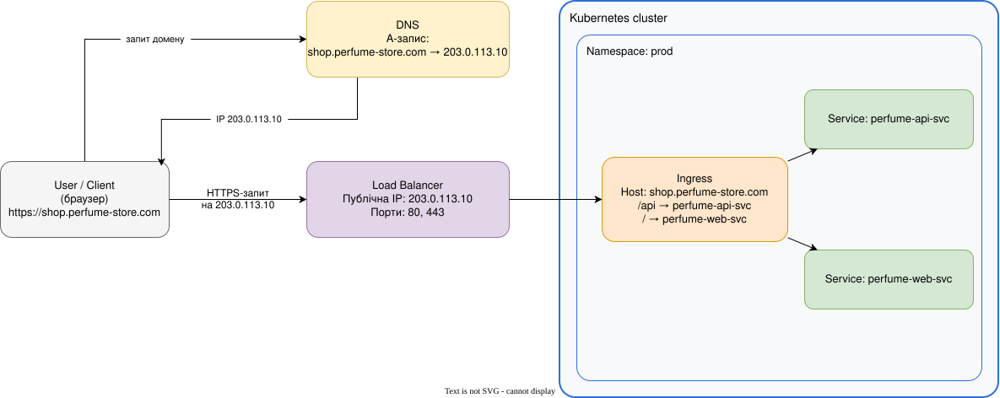
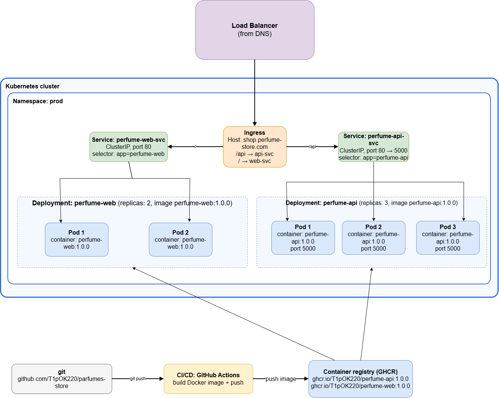

# Практична робота 9: Теоретична схема Kubernetes-додатку

## Обраний сервіс

Parfume Store — це вебзастосунок для онлайн-продажу парфумерії: користувач переглядає каталог ароматів і оформлює замовлення через веб-інтерфейс. Застосунок складається з frontend (React/Vite), backend API (Node.js) та бази даних PostgreSQL. Користувачі — покупці, які переглядають каталог і купують парфуми, та адміністратор, який керує товарами й замовленнями.

## Опис дизайну

Я моделюю вебзастосунок Parfume Store, який складається з фронтенду (perfume-web) і REST API (parfume-api) і працює в Kubernetes-кластері в namespace prod. Користувач відкриває https://shop.perfume-store.com: DNS повертає IP Load Balancer 203.0.113.10, Load Balancer передає запит в Ingress, а Ingress за Host shop.perfume-store.com і Path спрямовує його до Service: /api до perfume-api-svc, а / до perfume-web-svc. Обидва Service мають тип ClusterIP і розподіляють трафік між Pod-ами своїх Deployment-ів: perfume-api працює у 3 репліках (образ perfume-api:1.0.0), perfume-web у 2 репліках (образ perfume-web:1.0.0), щоб вихід з ладу одного Pod-а не зупиняв сервіс. Код зберігається в git-репозиторії github.com/T1pOK220/parfumes-store, після git push GitHub Actions збирає Docker-образи та публікує їх у container registry GHCR, а Pod-и завантажують ці образи з registry під час старту.
